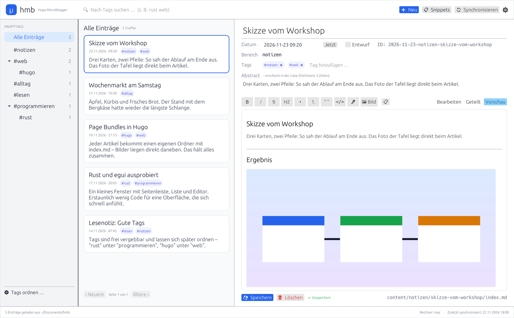
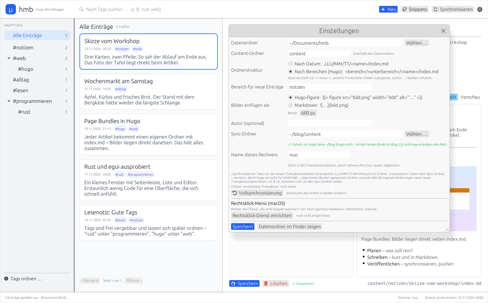
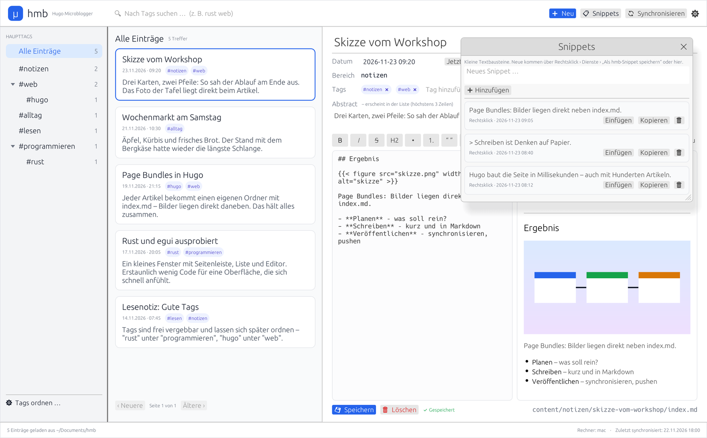
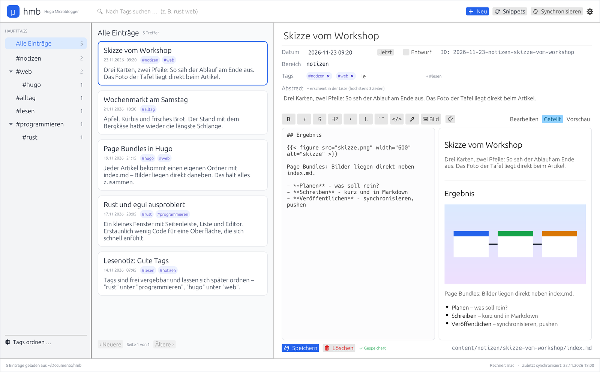
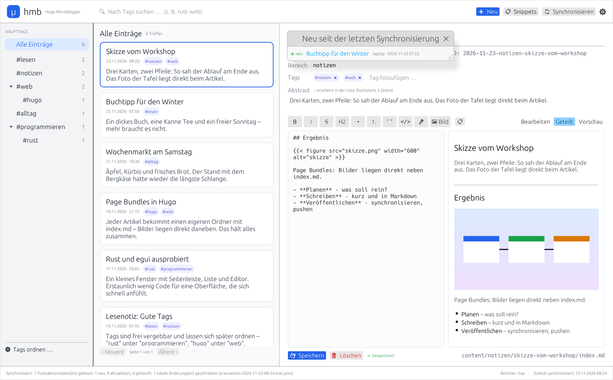

# hmb – Einführung

**hmb** (Hugo Microblogger) ist eine kleine App für kurze Markdown-Artikel. Du schreibst in hmb, sammelst
Textbausteine per Rechtsklick und gleichst alles per Knopfdruck mit dem `content`-Ordner deines
Hugo-Blogs ab. Das Hochladen ins Netz übernimmt Git – außerhalb der App.



**Der Ablauf in fünf Schritten:**

1. [Konfiguration – dein bestehendes Hugo-Content-Verzeichnis eintragen](#1-konfiguration)
2. [Snippets per Rechtsklick aufnehmen](#2-snippets-per-rechtsklick-aufnehmen)
3. [Artikel schreiben und Snippets benutzen](#3-artikel-schreiben-und-snippets-benutzen)
4. [Synchronisieren](#4-synchronisieren)
5. [Außerhalb der App: das Repository pushen](#5-außerhalb-der-app-das-repository-pushen)

---

## 1. Konfiguration

Öffne die Einstellungen über das Zahnrad **⚙** oben rechts.



| Feld | Was eintragen | Beispiel |
|---|---|---|
| **Datenordner** | Ein **eigener** Ordner für hmb – nicht der Blog selbst. | `~/Documents/hmb` |
| **Content-Ordner** | Unterordner mit den Artikeln im Datenordner. | `content` |
| **Ordnerstruktur** | Wie dein Blog aufgebaut ist. Bestehende Hugo-Blogs mit Bereichen: **Nach Bereichen**. | `technik/hugo/page-bundles/index.md` |
| **Bereich für neue Einträge** | Wohin neue Artikel kommen. | `notizen` |
| **Bilder einfügen als** | Hugo-`figure` oder normales Markdown, dazu die Breite. | `` |
| **Autor** | Wird in neue Artikel geschrieben (optional). | |
| **Sync-Ordner** | Der **`content`-Ordner deines Hugo-Blogs**. | `~/blog/content` |
| **Name dieses Rechners** | Erscheint in den Transaktionsdateien. | `mac` |

Wenn der Sync-Ordner richtig gewählt ist, zeigt hmb darunter grün
**„✔ Gehört zur Hugo-Seite … (hugo.toml)“**.

> **Wichtig:** Datenordner und Sync-Ordner müssen zwei *getrennte* Ordner sein. Wählst du beide gleich
> oder ineinander, warnt hmb in Rot und bietet „Eigenen Datenordner verwenden“ an.

Klicke auf **Speichern** und danach einmal auf **⟲ Vollsynchronisierung**: Alle Artikel aus deinem Blog
kommen in die App, und alles, was nur in der App liegt, kommt in den Blog.

---

## 2. Snippets per Rechtsklick aufnehmen

Snippets sind kleine Textbausteine – ein Zitat, eine Idee, ein Satz aus einer Webseite.

**Einmalig einrichten:** In den Einstellungen unter *Rechtsklick-Menü (macOS)* auf
**„Rechtsklick-Dienst einrichten“** klicken. Daneben steht danach „✔ eingerichtet“.
(Hast du die App verschoben oder umbenannt, steht dort ein Hinweis – dann einfach **„Neu einrichten“**.)

**Aufnehmen:** Markiere irgendwo auf dem Mac Text – in Safari, Mail, Notizen … – und wähle
**Rechtsklick › Dienste › „Als hmb-Snippet speichern“**. Das Snippet ist sofort in hmb, auch wenn die App
gerade offen ist.

Alle Snippets siehst du über den Knopf **📋 Snippets** oben. Dort kannst du auch selbst welche
hinzufügen, kopieren oder löschen.



---

## 3. Artikel schreiben und Snippets benutzen

**➕ Neu** legt einen Artikel an (Tastenkürzel ⌘N). Oben stehen Titel, Datum, Bereich und Tags,
darunter der **Abstract** (erscheint in der Liste, höchstens drei Zeilen) und der eigentliche Artikel in
Markdown. Rechts siehst du die Vorschau – umschaltbar zwischen *Bearbeiten*, *Geteilt* und *Vorschau*.



- **Snippet einfügen:** Rechtsklick in den Text › *Snippet einfügen*, oder der Knopf **📋** in der
  Werkzeugleiste, oder **Einfügen** im Snippets-Fenster. Das Snippet landet an der Cursor-Stelle.
- **Formatieren:** Knöpfe für Fett, Kursiv, Überschrift, Listen, Zitat, Code und Link – oder per Rechtsklick.
- **Tags:** Tippen und Enter. Vorhandene Tags werden vorgeschlagen. Über **Tags ordnen …** links unten
  legst du Ober- und Unterbegriffe fest (z. B. `rust` unter `programmieren`).
- **Bilder:** **🖼 Bild** klicken oder ein Bild einfach ins Fenster ziehen. Es wird in den Ordner des
  Artikels kopiert, und der passende Tag steht sofort im Text.
- **Speichern** passiert automatisch (oder ⌘S). Jeder Artikel ist ein eigener Ordner mit `index.md`
  und seinen Bildern – genau so, wie Hugo es erwartet.

---

## 4. Synchronisieren

Klicke oben auf **🔄 Synchronisieren**. hmb

1. liest im Ordner `transactions/` **neben** dem Blog-`content` nur die neuen Dateien
   `transaction-JJJJ-MM-TT-HH-mm.json` und übernimmt die dort genannten Artikel (neue werden
   importiert, vorhandene überschrieben),
2. kopiert deine eigenen Änderungen in den Blog und schreibt dazu eine neue Transaktionsdatei,
3. merkt sich, welche Transaktion zuletzt verarbeitet wurde.

Was von anderen Rechnern kam, zeigt das Fenster **„Neu seit der letzten Synchronisierung“** – ein Klick
auf den Titel öffnet den Artikel.



So sieht der Blog danach aus – Transaktionen, Snippets und Tags liegen **neben** `content`, nie darin,
damit Hugo sie nicht für Inhalt hält:

```
blog/
├── hugo.toml
├── content/                         nur Artikel
│   └── notizen/skizze-vom-workshop/
│       ├── index.md
│       └── skizze.png
├── transactions/                    nur flache Dateien
│   ├── transaction-2026-11-23-07-55-laptop.json
│   └── transaction-2026-11-23-08-23-mac.json
├── snippets.json
└── tags.json
```

Die **Vollsynchronisierung** in den Einstellungen vergleicht dagegen *alle* Artikel in beiden Ordnern –
praktisch beim ersten Mal oder wenn etwas durcheinandergeraten ist.

---

## 5. Außerhalb der App: das Repository pushen

hmb schreibt nur in deinen lokalen Blog-Ordner. Veröffentlicht wird wie gewohnt mit Git, zum Beispiel
im Terminal:

```sh
cd ~/blog
git status                      # was hat sich geändert?
git add content transactions snippets.json tags.json
git commit -m "Neue Einträge aus hmb"
git pull --rebase               # Änderungen von anderen Rechnern holen
git push
```

Je nach Einrichtung baut danach dein Hosting (z. B. GitHub Pages, Netlify) die Seite automatisch neu.
Vorher anschauen kannst du sie lokal mit `hugo server` im Blog-Ordner.

Auf einem zweiten Rechner: erst `git pull`, dann in hmb **Synchronisieren** – die neuen
Transaktionsdateien bringen die Artikel in die App.

---

## Bilder dieser Anleitung neu erzeugen

```sh
./doc/make-screenshots.sh
```

Das Skript baut in einem Temp-Ordner einen Beispiel-Blog und fotografiert hmb in jedem Schritt.
Deine echten Einstellungen und Artikel werden dabei nicht angefasst.
